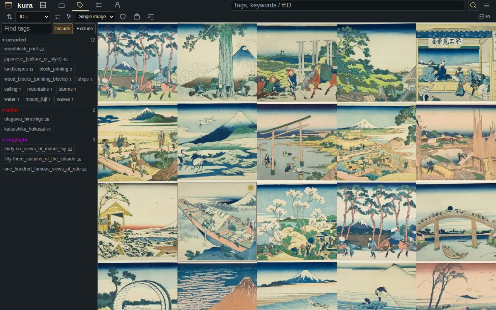
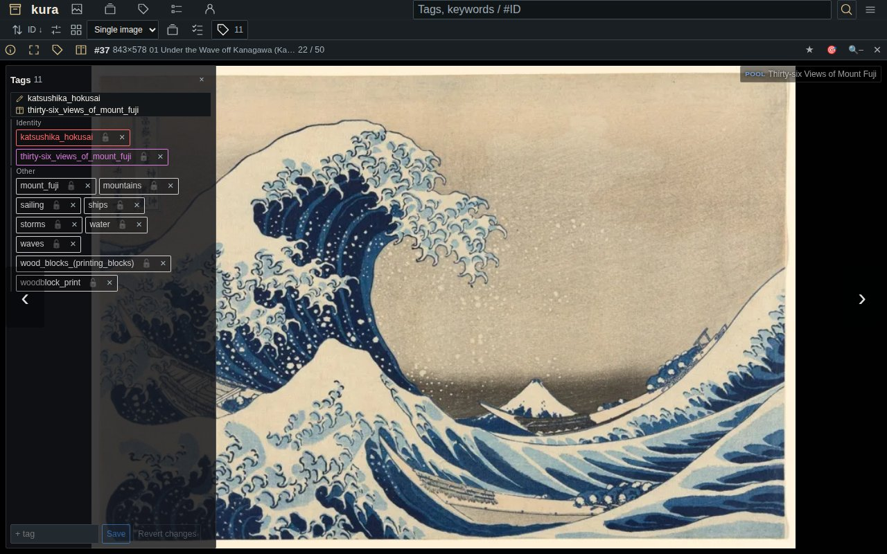

# kura

A self-hosted archive for your image and video collection, built for libraries of hundreds of
thousands of files. Tag it, search it, keep series in order as pools, read them page by page,
and let the optional auto-tagger do the first pass.



- **Search by tags**: tags in categories (artist, character, copyright and more), aliases,
  several tags at once and exclusions.
- **Pools**: series and books kept in order, with a page-by-page reader.
- **Bring what you have**: drag files or folders onto the page, import a folder from the
  command line (or have `--watch` pick up new files as they arrive), take comic archives
  (.zip, .cbz) as pools, take the tags that sit next to your files (booru JSON, XMP keywords,
  text files, ComicInfo.xml), or bring the images and videos of a szurubooru or Hydrus
  library, or the archives of a LANraragi, over with their tags.
- **Auto-tagging** (optional): a WD14 tagger tags new images; it runs on a CPU, a GPU only
  makes it faster.
- English and Japanese interface. Runs on one Linux machine, natively or with Docker Compose.



The API is FastAPI on PostgreSQL; the web front end is SvelteKit. The screenshots show prints
by Hokusai and Hiroshige from the Art Institute of Chicago's public-domain collection (CC0).

## Requirements

- Linux with systemd (tested on Ubuntu 26.04)
- PostgreSQL 18 with `pgvector` (`pg_trgm` and `fuzzystrmatch` ship with PostgreSQL itself),
  and `sudo` to run `psql` as `postgres`
- Python 3.14, Node.js 22.23.4, 24.22.1, 26.12.1 or newer (Node's October 2026 security
  releases; `npm ci` refuses a lower version number, including a distribution build that
  backports fixes), `ffmpeg`, `git`

On Ubuntu 26.04 Node.js comes from its snap, which tracks Node's own releases (the
distribution's `nodejs` package stays on 22.22.1), and the rest from the distribution:

```bash
sudo apt update
sudo apt install git postgresql-18 postgresql-18-pgvector python3-venv ffmpeg
sudo snap install node --classic --channel=24/stable
```

## Install

```bash
git clone https://github.com/unagikudari/kura-public.git ~/kura && cd ~/kura

# 1. The API's Python environment
python3 -m venv ~/.local/share/kura-api/venv
~/.local/share/kura-api/venv/bin/pip install -r api/requirements.lock

# 2. Settings: writes api/env and web/.env.server (0600) with every secret generated.
#    --origin is the address people will open kura at.
python3 ops/install/make_env.py --origin https://kura.example.org --data-dir ~/kura-data

# 3. The database: roles, database, extensions and the schema (asks for sudo).
~/.local/share/kura-api/venv/bin/python ops/install/database.py create

# 4. The first administrator. The sign-in key goes to the file you name, never to the screen.
~/.local/share/kura-api/venv/bin/python scripts/create_admin.py create \
    --name admin --email you@example.org --output ~/kura-admin.key

# 5. The web front end. Its origin is fixed at build time from ORIGIN in web/.env.server,
#    so to change it later, edit that line and build again.
(cd web && npm ci && npm run build)

# 6. Start both
mkdir -p ~/.config/systemd/user
cp systemd/user/kura-api.service systemd/user/kura-web.service ~/.config/systemd/user/
systemctl --user daemon-reload
systemctl --user enable --now kura-api kura-web
sudo loginctl enable-linger "$USER"   # keep them running after you log out, and start them at boot
```

The web server listens on `127.0.0.1:3000`. Serve your `--origin` from it through a reverse
proxy that terminates HTTPS; sign-in only works when the browser comes in on exactly that
origin. With nginx, for example:

```nginx
server {
    listen 443 ssl;
    server_name kura.example.org;
    ssl_certificate     /etc/ssl/kura/fullchain.pem;
    ssl_certificate_key /etc/ssl/kura/privkey.pem;
    client_max_body_size 512m;

    location / {
        proxy_pass         http://127.0.0.1:3000;
        proxy_set_header   Host $host;
        proxy_set_header   X-Forwarded-For $proxy_add_x_forwarded_for;
        proxy_set_header   Upgrade $http_upgrade;
        proxy_set_header   Connection "upgrade";
        proxy_read_timeout 300s;
    }
}
```

Open your origin and sign in with your email and the key in `~/kura-admin.key`. Keep that file
private; delete it once you have stored the key somewhere safe.

## Install with Docker

Instead of the steps above, with Docker and its Compose plugin:

```bash
git clone https://github.com/unagikudari/kura-public.git ~/kura && cd ~/kura
python3 ops/install/make_env.py --docker --origin http://localhost:3000
docker compose up -d --build
docker compose run --rm tools python scripts/create_admin.py create \
    --name admin --email you@example.org --output /out/kura-admin.key
```

Open http://localhost:3000 and sign in with your email and the key in `~/kura/kura-admin.key`.
The database, the images and the settings stay in Docker volumes and in `api/env`,
`web/.env.server` and `.env` (all 0600).

The web listens on 127.0.0.1:3000 only. To serve it to other machines, give `make_env.py` the
address people will open (`--origin https://kura.example.org`) and put an HTTPS reverse proxy
(the nginx block above works) in front of port 3000; `KURA_BIND` and `KURA_PORT` in `.env`
change where it listens.

To add the auto-tagger (see "Auto-tagging" below for what it does):

```bash
docker compose --profile tagger build tagger
docker compose --profile tagger run --rm tagger python tagger/build_release.py --base-only --output-dir /models/release
docker compose run --rm tools python tagger/publish_release.py --build-dir /models/release
docker compose run --rm tools python scripts/tagger_worker_setup.py \
    --user admin --output /out/tagger/env --url http://api:8001 --host kura-tagger
docker compose --profile tagger up -d
```

To upgrade: `docker compose --profile tagger down`, `git pull`, then
`docker compose --profile tagger up -d --build` (leave out `--profile tagger` if you did not add it).
The schema upgrade runs before the API starts.

## Language

The interface is in English or Japanese. It follows your browser's language until you pick one
under Menu → Language. To set the default for everyone who has not picked one, put
`KURA_UI_LOCALE=en` or `KURA_UI_LOCALE=ja` in `web/.env.server`.

## Adding images

Drag image or video files, or whole folders, onto the kura page, or paste a copied image
(Ctrl+V). Each one is in the list as soon as it has been added.

For a large folder, or one on the server, there is a command line instead. It needs only
Python 3 and the sign-in key you got from `create_admin.py`:

```bash
python3 scripts/kura_import.py --url http://127.0.0.1:8001 \
    --email you@example.org --key-file ~/kura-admin.key ~/Pictures/scans \
    --tags "scan 2024" --safety safe --pool-per-folder
```

Every image and video under the folder is added in natural order (page 2 before page 10);
other files are passed over. `--pool-per-folder` makes a pool of each folder, `--pool NAME`
puts everything in one pool, `--tags` and `--source` go on every file. Files kura already
holds are reported as duplicates. If the run is interrupted, run it again: what was already
sent is skipped, and a file kura refused is tried again only once it has changed. When a file
cannot go in, the files behind it in the same pool wait for it, so a pool keeps its order.
`--dry-run` lists what would be sent. With Docker, `--url http://api:8001`
and mount the folder:

```bash
docker compose run --rm -v ~/Pictures/scans:/import:ro tools \
    python scripts/kura_import.py --url http://api:8001 --email you@example.org \
    --key-file /out/kura-admin.key --record /out/kura-import.jsonl /import
```

If other tools left tags next to the images, `--sidecars` takes them too. For `photo.jpg` it
reads `photo.jpg.json` or `photo.json` (a booru post's JSON: its tags, the artist, character
and copyright groups, rating and source), `photo.jpg.xmp` or `photo.xmp`
(XMP keywords, as digiKam, darktable or Lightroom write them) and `photo.jpg.txt` or
`photo.txt` (a tag per line as Hydrus writes them, or comma-separated). `creator:`,
`artist:`, `character:` and `series:`/`copyright:` tags get kura's category, and a rating
(`rating:explicit`, or the booru letters g/s/q/e) sets the safety unless you gave `--safety`.
Spaces in a tag become underscores. A sidecar added or edited later sends its image again
on the next run, and kura adds the new tags to the post it already has (tags taken out of a
sidecar stay on the post).

Comics and other books kept as `.zip` or `.cbz` archives come in with `--archives`: each
archive becomes a pool holding its pages in order (pages in a subfolder of the archive after
the ones above it), named by its path in the folder (`Night Ferry`, or `Orbital Notes / Vol 1`
for an archive in a subfolder), and with `--sidecars` the archive's `ComicInfo.xml` gives its
pages tags (writer and artists, characters, series, genre and tags), a rating and a source.
Hidden entries, macOS leftovers and two entries of one name inside are passed over, and so
is a page that would unpack to more than 100 times its packed size or to more than 1 GiB; a
page that is damaged fails on its own. A page added to an archive later is sent on the next
run without sending the others again; an edited `ComicInfo.xml` sends the pages again so
kura adds the new tags.

To keep a folder in kura, add `--watch 60`: the command stays running, looks at the folder
every 60 seconds and sends what was added or changed, once a file has not changed for
`--settle` seconds (10 by default, so a file still being copied waits). A file kura refused
stays out until it changes. To run it in the background and at boot, as a user service:

```ini
# ~/.config/systemd/user/kura-import-watch.service
[Unit]
Description=Keep ~/Pictures/inbox in kura

[Service]
ExecStart=/usr/bin/python3 %h/kura/scripts/kura_import.py %h/Pictures/inbox --watch 60 \
    --url http://127.0.0.1:8001 --email you@example.org --key-file %h/kura-admin.key
Restart=on-failure

[Install]
WantedBy=default.target
```

`systemctl --user enable --now kura-import-watch`, and `journalctl --user -u kura-import-watch`
shows what it sent. It signs in only when there is something to send. Keep the key file
somewhere the service can read; it must stay mode 0600.

## Moving in from szurubooru

If your collection lives in a szurubooru, one command brings it over through the two APIs:
every post with its tags, safety and source, the tag categories kura also has, and the
pools in their order. It needs a szurubooru login token (Account → Login tokens) in a file:

```bash
python3 scripts/szurubooru_migrate.py \
    --from https://booru.example.org --from-user you --from-token-file ~/booru.token \
    --url http://127.0.0.1:8001 --email you@example.org --key-file ~/kura-admin.key
```

`--dry-run` first shows what would move. A run that is interrupted continues where it stopped
when you run it again. Tags of the szurubooru category `artist` become artist tags in kura
(`--artist-category` if yours is named differently).

## Moving in from Hydrus

A Hydrus Network library moves over through its Client API (services → manage services →
client api: a key with "search for files", saved to a file):

```bash
python3 scripts/hydrus_migrate.py \
    --from http://127.0.0.1:45869 --from-key-file ~/hydrus-api.key \
    --url http://127.0.0.1:8001 --email you@example.org --key-file ~/kura-admin.key
```

Every current file comes over with its tags: `creator:` tags become artist tags,
`series:` copyright, `character:` character (`--namespace` changes the mapping; other
namespaces keep their text), and the file's first known URL becomes its source. Hydrus has
no safety rating, so `--safety` (default `unsafe`) applies to all of them. `--dry-run` and
resuming work as for szurubooru.

## Moving in from LANraragi

A LANraragi library moves over through its API. Each archive becomes a pool of its pages in
order, with the archive's tags on every page:

```bash
python3 scripts/lanraragi_migrate.py --from http://127.0.0.1:3000 \
    --url http://127.0.0.1:8001 --email you@example.org --key-file ~/kura-admin.key
```

`artist:` and `group:` tags become artist tags, `character:` character tags, `parody:` and
`series:` copyright tags (`--namespace` changes the mapping); `source:` becomes the source,
`date_added:` is left out, and other namespaces keep their text (`female:glasses`). Archives
are read as zip or cbz; a rar, 7z or pdf in the library is named and passed over, and so is
a damaged page. Two archives with the same title get their archive id in the pool name; a
book keeps the pool it started in. If
LANraragi runs in No-Fun Mode, give its API key in a 0600 file with `--from-key-file`.
`--safety` (default `unsafe`), `--dry-run` and resuming work as for the other migrations.

## Auto-tagging (optional)

A worker tags new images with the WD14 tagger (`SmilingWolf/wd-swinv2-tagger-v3`, about 400 MB,
downloaded once from Hugging Face). It runs on the CPU; a GPU only makes it faster. Run these
once, from `~/kura`:

```bash
# 1. The tagger's Python environment. torch and torchvision come from the same index — the CPU
#    build here; for an NVIDIA GPU use the CUDA index that pytorch.org names instead.
python3 -m venv ~/.local/share/kura-tagger/venv
~/.local/share/kura-tagger/venv/bin/pip install torch torchvision --index-url https://download.pytorch.org/whl/cpu
~/.local/share/kura-tagger/venv/bin/pip install -r tagger/requirements.txt

# 2. The first tagger release: the base model, published to the database.
~/.local/share/kura-tagger/venv/bin/python tagger/build_release.py --base-only --output-dir ~/kura-data/tagger-release
(set -a; . api/env; set +a; ~/.local/share/kura-api/venv/bin/python tagger/publish_release.py --build-dir ~/kura-data/tagger-release)

# 3. The worker's sign-in: a token for your user and this machine on the worker list,
#    written to tagger/env (0600). Use the name you gave create_admin.py.
~/.local/share/kura-api/venv/bin/python scripts/tagger_worker_setup.py --user admin --output tagger/env

# 4. Start it
cp systemd/user/kura-tagger-worker.service ~/.config/systemd/user/
systemctl --user daemon-reload
systemctl --user enable --now kura-tagger-worker
```

`journalctl --user -u kura-tagger-worker` shows each image it tags. Images added before the
worker started are tagged too.

## Upgrading

An install that took Node.js from the distribution's `nodejs` package (as this README said
before 1.290.6) switches to the snap once: run `sudo apt remove nodejs npm && sudo snap install
node --classic --channel=24/stable` first, and after `git pull` below also
`cp systemd/user/kura-web.service ~/.config/systemd/user/ && systemctl --user daemon-reload`
(the old unit started `/usr/bin/node`).

```bash
cd ~/kura
systemctl --user stop kura-api kura-web
git pull
~/.local/share/kura-api/venv/bin/pip install -r api/requirements.lock
~/.local/share/kura-api/venv/bin/python ops/install/database.py upgrade
(cd web && npm ci && npm run build)
systemctl --user start kura-api kura-web
```

`database.py upgrade` is needed because some schema changes replace objects owned by a
separate database role; the API's own role is never given that privilege
(`docs/notes/fresh-install-baseline.md`).

## A lost sign-in key

```bash
~/.local/share/kura-api/venv/bin/python scripts/create_admin.py recover --user-id 1 --output ~/kura-admin.key
```

The old key stops working and a new one is written to the file.

## License

kura is free software under the GNU Affero General Public License v3.0 — see [LICENSE](LICENSE).
The menu links to this repository; if you run a modified kura for other people over a network,
set `KURA_SOURCE_URL` in `web/.env.server` to where your modified source can be had.
