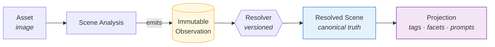
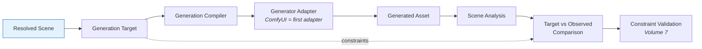

# Kura 1.0 — Pipelines

- **Status:** Draft — **Version:** 0.1.0
- **Scope:** The canonical processing pipeline and the generation/validation loop
  ([Volume 1](../standard/volume-01-core-architecture.md) §3). Mermaid, git-tracked.

## Processing pipeline

- Each stage consumes the previous **without mutating** it.
- Scene Analysis emits **observations only**; the **Resolver** alone produces the
  resolved scene; **projections** are derived and rebuildable (never truth).

## Generation & validation loop

- A generated asset **re-enters Scene Analysis**, so observed output is represented
  with the same observation model as any asset.
- The generator is an **adapter behind a generator-agnostic representation** (INV-8).
