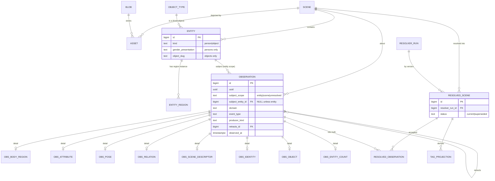
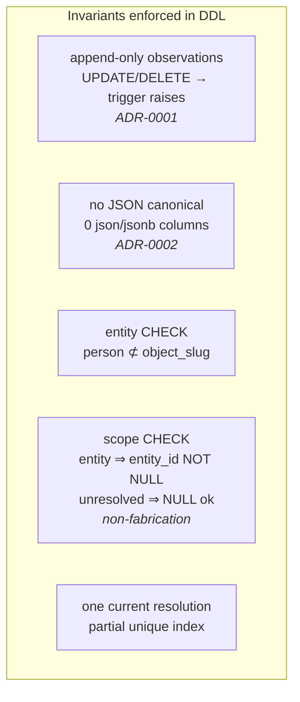

# Kura 1.0 — Data Model

- **Status:** Draft — **Version:** 0.1.0
- **Scope:** The core of the canonical schema
  ([database/schema.sql](../../database/schema.sql)) — scenes, assets, entities, the
  append-only observation model, and Resolver-owned resolution. Ontology tables are
  summarised in [03-ontology-and-entities.md](./03-ontology-and-entities.md).

## Core entity-relationship

## What the schema enforces (verified on PG18)

- `subject_scope='unresolved'` with a NULL entity is the **non-fabrication** outcome:
  a person-scoped fact in a multi-entity scene is recorded without guessing which
  entity holds it.
- Each `observation` carries one per-domain detail row (relational, JSON-free);
  corrections are **new** observations, retractions set `retracts_id`.
