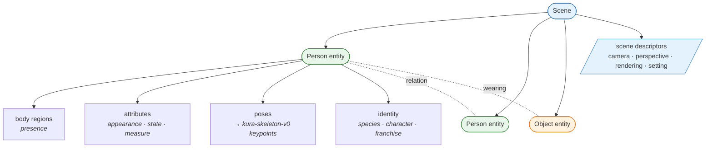
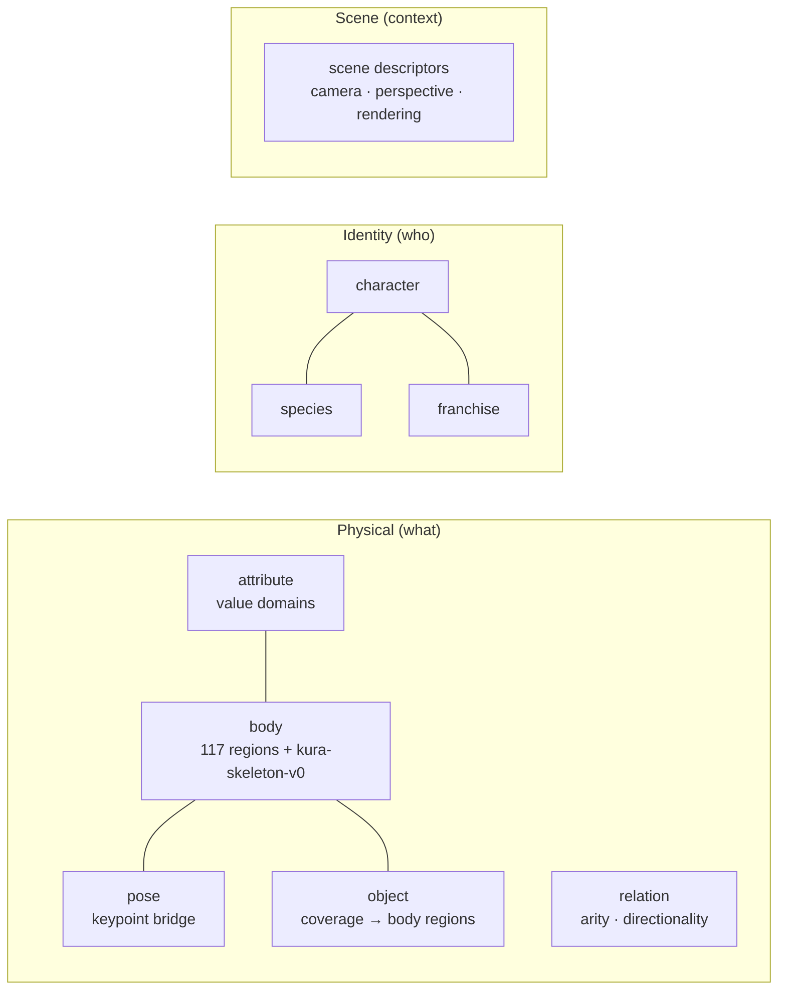

# Kura 1.0 — Ontology & Entity Attachment

- **Status:** Draft — **Version:** 0.1.0
- **Scope:** The ontology domains and how they attach to scene entities
  ([Volume 3](../standard/volume-03-ontology.md), the `ontology/*` specs).

## Ontology domains attaching to a scene

- **Physical** ontologies (body / attribute / pose) describe *what* an entity is;
  **identity** (species / character / franchise) describes *who* it is — kept
  separate (a depiction may deviate from a character's canonical traits).
- **scene descriptors** (camera angle, perspective, rendering, setting) are
  scene-level, not per-entity.

## The ontology layer

Every ontology term is **data** (`database/seed/*`), stable-id'd, and loadable into
the DDL's ontology tables — none hardcoded in application source.
