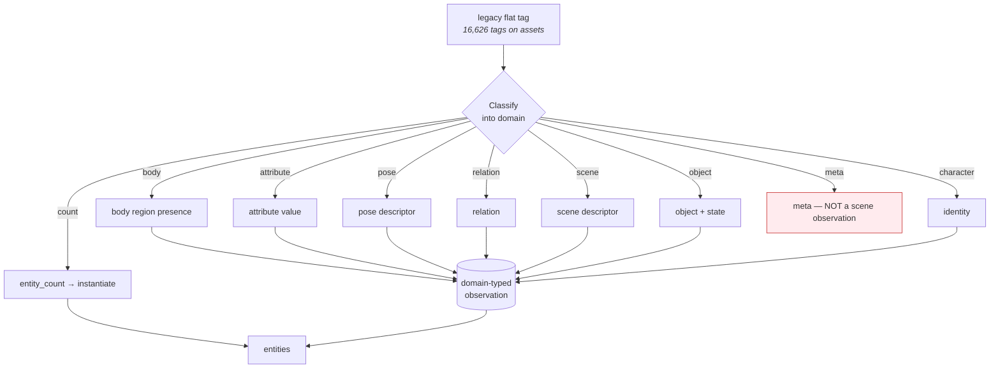
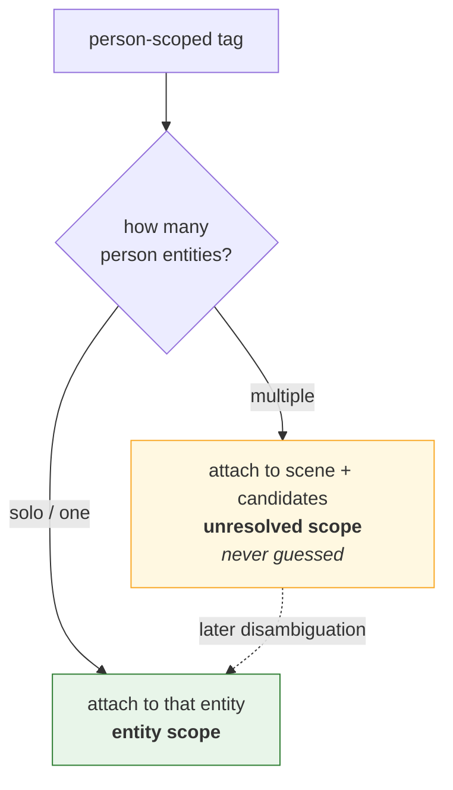
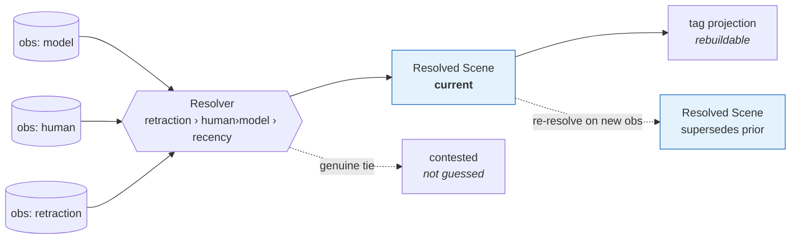

# Kura 1.0 — Reconciliation & Resolution

- **Status:** Draft — **Version:** 0.1.0
- **Scope:** How the existing legacy flat-tag data reconciles into Kura 1.0
  ([RECONCILIATION.md](../../database/RECONCILIATION.md),
  [ENTITY-RESOLUTION.md](../../database/ENTITY-RESOLUTION.md)), and how the Resolver
  folds observations into truth ([resolver-specification.md](../standard/resolver-specification.md)).

## legacy flat tags → Kura 1.0 (reconciliation)

- Reconciliation is **not a rename**: each flat tag is classified and re-expressed as
  the right ontology object. `meta` tags (auto_tagme, censored, stats) are **not**
  scene observations.
- legacy `asset_tag_events` (append-only) map directly to Kura observations — an
  **additive re-projection** that never mutates legacy.

## Attachment & the non-fabrication rule

## Observations → Resolver → resolved scene

- Conflicts resolve by **retraction › producer precedence (human > model) › recency**,
  over a deterministic order (`observed_at`, then `id`).
- A genuine tie/contradiction is **contested**, not guessed; re-resolution produces a
  **new** resolved scene (old → superseded), never a mutation.
