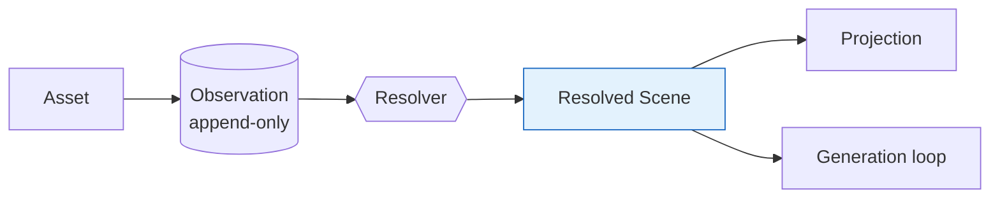

# Kura 1.0 — Diagrams

- **Status:** Draft — **Version:** 0.1.0
- **Scope:** Version-controlled **Mermaid** diagrams of the Kura 1.0 design (renders
  natively on GitHub; diffable text). These are **design** diagrams (the intended
  architecture); the live schema is shown separately by the broker schema dashboard.

| Diagram | Shows |
|---|---|
| [01-pipelines](./01-pipelines.md) | processing pipeline + generation/validation loop (Volume 1 §3) |
| [02-data-model](./02-data-model.md) | schema core ER + the DDL-enforced invariants |
| [03-ontology-and-entities](./03-ontology-and-entities.md) | ontology domains attaching to entities/scenes |
| [04-reconciliation-and-resolution](./04-reconciliation-and-resolution.md) | legacy flat tags → observations; Resolver → resolved scene |

## 現行システム (runtime) — archify HTML

Kura 1.0 の設計図 (上表・Mermaid) と別に、**今動いているシステム**の図。archify skill 製の
self-contained HTML (inline SVG + viewer: テーマ切替 / pan-zoom / guided views / export)。
ブラウザで直接開く (GitHub 上ではレンダリングされないので raw を保存するか checkout で開く)。
ソースは同名の `.archify.json` — 図を直すときは JSON を編集して archify で re-deliver する
(HTML を手で編集しない)。

| Diagram | Shows |
|---|---|
| [runtime-architecture.html](./runtime-architecture.html) | 現行 runtime トポロジー — primary canonical (Tailscale Serve :8443 / kura-api / kura-web / PG16 / importers / tagger fleet) + trainer 一方向 replica |
| [ml-loop.html](./ml-loop.html) | 取り込み → タグ → 学習 → 生成 → 再投入 の end-to-end ML ループ (CLAUDE.md「kura は一つのプロジェクト」の視覚化) |

## The whole picture in one line

Design-phase coverage (KTS-HANDOFF-001): foundation → 8 standard volumes + ADRs →
ontology (body/attribute/relation/scene/object/pose/identity) → reconciliation →
entity-resolution → **production DDL** → **Resolver spec** → **diagrams**. This
closes the design phase; what remains is implementation (seed loading, full tag
classification + re-projection, Resolver code) and the policy DDL.
